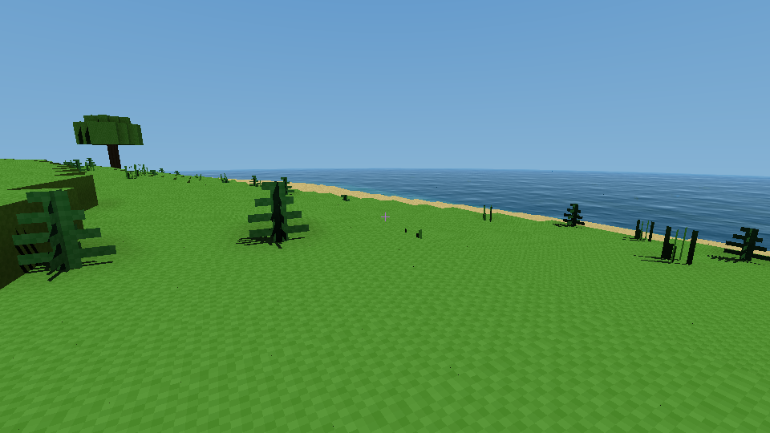

# BlockWorld — Rust + direct Vulkan voxel study

A small playable first-person voxel sandbox. Procedural terrain, fourteen voxel block types, skeletal fish, alpha-cutout grass/ferns,
walking/jumping/swimming, collision, block removal and placement. No game engine.
The Vulkan implementation uses **ash**, exposing the actual Vulkan API.

## Build and run

Install stable Rust with rustup, **glslc** (shaderc tools), and a Vulkan 1.2 driver/loader.
Linux audio also needs ALSA development libraries (`libasound2-dev`) and `pkg-config`. On Linux,
Mesa's lavapipe software Vulkan also works (more slowly). A desktop session is
required for the window, but not for headless rendering. `build.rs` compiles the
portable compute shaders through Naga and the two Vulkan ray-query shaders through
`glslc`. On Debian/Ubuntu the shader compiler is supplied by `glslc`; the complete
Vulkan SDK is optional. Dear ImGui renders a live debug overlay through Vulkan. Dependencies are pinned by `Cargo.lock`.

```sh
cargo build --locked
cargo run --release --locked
cargo test --locked
cargo run --release --locked -- --smoke-test /tmp/blockworld.ppm
```

If using the temporary toolchain installed during creation of this example:

```sh
export CARGO_HOME=/tmp/blockworld-cargo
export RUSTUP_HOME=/tmp/blockworld-rustup
export PATH="$CARGO_HOME/bin:$PATH"
cargo run --release --locked
```

Optional validation (requires the Khronos validation layer installed):

```sh
BLOCKWORLD_VALIDATION=1 cargo run --locked -- --smoke-test /tmp/blockworld.ppm
```

`--headless [file.ppm]` renders one terrain frame. `--smoke-test [file.ppm]`
also verifies hierarchy/culling parity, transparent water, off-screen sun shadows,
SSAO corner darkening, block editing, skeletal animation, triangle-backend parity,
alpha-tested visibility/shadows, water SSR/bump, close-up primary occlusion, asynchronous streaming,
cache eviction/edit replay, AS ring consistency, and all twelve debug views.
`--water-view` starts above a lake; `--no-ssr` and `--no-waves` disable the new
water effects independently. `--water-test` runs their GPU regression fixture.
`--frames N` exits the interactive window after N frames, useful for a startup test.
`--stream-test --frames 1000` stresses turning, movement, view-distance changes
and cache pressure. It prints frame-time percentiles and main-thread timings.
Use `--no-hierarchy`, `--no-culling`, `--no-ssao`, `--no-shadows` and
`--opaque-water` for performance or visual comparisons. ImGui exposes the same
switches plus AO radius/strength, water density and sun azimuth/elevation/intensity.
`--no-meshes` measures the voxel-only baseline, `--no-rt` selects software triangle
traversal, `--freeze-animation` holds a replay pose, and `--rebuild-blas` rebuilds
fish BLASes each frame instead of refitting them. Set
`BLOCKWORLD_DISABLE_RAY_QUERY=1` to disable the optional device features and AS
allocations entirely when testing the unsupported-device fallback. ImGui also toggles fish, foliage,
alpha testing and animation independently.

See [verification results](docs/VALIDATION.md) for build checks and a measured
stationary-camera benchmark.



## Controls

| Input | Action |
|---|---|
| Click | Capture mouse; first click does not edit |
| WASD / mouse | Walk / look |
| Space | Jump; swim upward and jump out onto the shore |
| Left / right Ctrl (or Left Shift) | Run while held |
| Left / right mouse | Delete targeted block / place against targeted face |
| 1 / 2 / 3 / 4 / 5 / 6 / 7 | Stone / grass / dirt / sand / water / wood / snow |
| F11 | Show/hide developer HUD |
| F2 | Toggle fly camera (WASD, Space/C rise/fall, Ctrl/Shift boost) |
| F1 | Cycle shaded / normals / depth / material / UV / AO / water / sun / traversal / mesh flags / reflection coverage / bump normals / Fresnel-TIR / water path / reflected material |
| Escape | Release mouse |

Airborne motion retains horizontal momentum when any WASD or run key is released,
including diagonal movement. Grounded movement and swimming remain responsive.

Placement cannot intersect the player's body. Reach is 7 m. Water is non-solid
and transparent by default. ImGui shows selected material and player coordinates;
release the mouse with Escape to adjust rendering controls. Body immersion keeps
swimming active after your head surfaces. Hold Space while moving toward shore
to clear a one-block bank; solid ceilings still block ascent.
ImGui includes an **Auto-jump** checkbox (off initially). It jumps when walking
into a one-block obstacle with enough headroom; two-block walls do not trigger it.
The **View distance (chunks)** slider selects a ray radius of 1–128 chunks,
initially 8 chunks / 128 m. `--view-chunks N` sets it at startup.
`--lod-pixels N` and the HUD control the projected voxel-size target (default 1).
Distant terrain loads progressively; see [Terrain LOD](docs/TERRAIN_LOD.md).
The CPU chunk-cache budget is configurable in ImGui or with `--cache-mb N`
(default 512 MiB). The active area stays pinned even if it exceeds that budget.

Terrain now combines ocean basins, erosion-shaped valleys, roughness-controlled
hills, cold ridged mountains and connected 3D cave fields. Seven climate-driven
biomes and their new blocks are listed in [Implemented biomes](docs/BIOMES.md).
Use `--biome desert --fly` (or another documented biome name) to inspect one.
Oak/pine tree density and surface materials vary with biome and climate.

Generated trees have stable grid identities, complete member lists and per-chunk
block ownership, including crowns crossing chunk/region boundaries. Breaking any
member removes the entire generated tree. Replacing a member detaches that block,
so player-built blocks survive subsequent tree removal. The edit journal prevents
removed trees returning after cache eviction; edits remain in memory for this run.
The HUD shows the targeted tree kind, identity, root and block count.

`--fly` starts in fly mode; `--underwater-view` starts submerged and looks up at
the refracted window and internally reflected scene. Underwater fog and water IOR
are adjustable under Lighting controls.

## World layout

All geometry constants live in `src/config.rs`, the Rust equivalent of C++
`constexpr`. Change `REGION_EDGE` to **16, 32 or 64**, then rebuild.

```text
World: HashMap<(region_x, region_z), Region>
  Region: heap-owned fixed [Option<Arc<Chunk>>; REGION_EDGE²]
    Chunk: fixed [Option<Box<SubChunk>>; 24] + tree descriptors and block ownership
      SubChunk: #[repr(C, align(64))] [Block; 16³]
        Block: #[repr(u8)] (Air + nine voxel material IDs; polygon IDs share atlas)
```

A block is 1 m³. A chunk covers 16×16 horizontal columns and 384 vertical
blocks. Four sections lie below zero: **Y ∈ [−64, 320)**. Subchunk zero starts
at −64; subchunk four starts at zero. Missing slots represent unloaded chunks
or all-air sections. Generated chunks are retained, so edits survive walking
away and returning during the same process.

Subchunk indexing is `x | (z << 4) | (y << 8)`: X contiguous, then Z, then Y.
Each subchunk occupies exactly 4096 bytes with 64-byte alignment. Region and
chunk arrays have compile-time lengths; `Box` keeps large allocations off the
stack. Euclidean division/remainder handle negative world coordinates correctly.

GPU block IDs occupy one byte per voxel; shaders unpack four IDs from each `u32`
word without requiring Vulkan 8-bit storage support. The exact window is bounded
at 19×19 chunks / 33.84 MiB of voxels, plus staging, active/retired windows,
occupancy and mesh/AS resources. A separate 64 MiB sparse GPU pool holds distant
voxel mip pages, prepared on the `terrain-lod` worker and uploaded incrementally.

The near worker builds occupancy/decoration data and uploads coherent exact windows
on chunk crossings or edits. The renderer keeps the previous window while that
job runs. Primary rays, optical rays, shadows and fog share the chosen range.
The LOD worker independently prepares 1/2/4/8/16-metre voxel levels, with bounded
RAM caching and a versioned key for future disk persistence. The effective pixel
target adapts to the distant GPU budget and is shown in the HUD.
Chunk/section dimensions and aligned CPU block storage remain compile-time constants. This intentionally simple upload is independent of CPU storage layout.
A 16×16 region therefore does **not** force generating all 256 chunks at once.

## Rendering

1. CPU frustum planes first reject chunk columns, then voxel sections for primary camera rays. The complete
   loaded occupancy remains available to shadows, including off-screen blockers.
2. Three-bone CPU skinning deforms the low-poly fish; separate instance matrices
   move them through deep-enough water. Grass/fern cards are grouped into 16³
   sections and rebuilt when the voxel snapshot changes.
3. On a worker, supported Vulkan devices refit **one triangle BLAS per fish**, retains
   static section foliage BLASes, and update their **TLAS** in a three-slot ring. Without ray-query
   support (or with `--no-rt`), a software triangle path uses object bounds.
4. Voxel visibility runs first, using section → 4³-block cell → voxel skipping.
   Its nearest opaque depth limits **alpha-accepted** polygon primary rays.
   A resolve pass replaces nearer fish/foliage hits and recomputes only their
   water-covered paths. The **64-byte layered visibility record** retains
   normal, depth, UV, material, flags, first water interface and water length.
   A block filling the screen therefore prevents distant polygon tests; sun
   shadows still query off-screen casters.
5. A separate **12-sample SSAO pass** reconstructs visible world positions. Holes
   in foliage already reveal their actual background at this stage. A normal/depth
   aware 3×3 filter smooths AO; AO affects ambient light, not direct sunlight.
6. A mesh sun-shadow pass uses the same alpha test; deferred shading combines it
   with hierarchical voxel shadows, warm Lambert sunlight and cool sky ambient.
   This writes an HDR scene-color buffer. A separate water composition pass adds
   Beer–Lambert extinction, depth-marched screen-space reflections with sky
   fallback, precomputed scrolling wave bump and sun highlights. The 64×64
   repeat texture has seven mip levels and up to 8× hardware anisotropic filtering.
   See [water rendering](docs/WATER.md) for limits, controls and measurements.
7. Vulkan copies output directly into the equally sized swapchain image. ImGui
   draws its overlay and `vkQueuePresentKHR` displays it. There is no frame
   readback, intermediate display image or scaling blit in the interactive path.

This is now a hybrid **software voxel + Vulkan triangle ray-query** renderer.
No triangle mesh is generated for voxel terrain. Fish and foliage are real triangle
geometry; only ImGui uses rasterization. Vulkan ray-query features are optional,
with automatic software fallback. Textures are generated 16×16 **RGBA** arrays.

The material table carries `ALPHA_MASK`, `DOUBLE_SIDED`, `TRANSMISSION` and an
alpha cutoff. Primary and shadow queries reject masked texels **before confirming
hits**. Writing a full card to visibility and hiding its holes afterward would
leave wrong depth for SSAO; this renderer does not do that. Mesh/alpha flags remain
in visibility for debug views and later material policies.

In a raycaster the camera rays already lie inside the frustum; there are no
mesh draw calls to remove. The explicit section mask and statistics demonstrate
conservative spatial culling. **Empty-space hierarchy traversal provides the
actual primary-ray skipping benefit**, rather than claiming mesh-style frustum
culling speedups. Culling never deletes occupancy needed by shadow rays.

Interactive rendering follows the swapchain's **physical pixel extent**, including
high-DPI windows. Resizing reallocates visibility, AO, mesh-hit, mesh-shadow and shaded-output buffers,
updates their descriptor bindings, and changes camera aspect ratio / dispatch
size before rendering the acquired image. Presentation is a tightly packed 1:1
GPU buffer-to-image copy, with no stretching or letterboxing. Minimized zero-size
surfaces retain their buffers and defer rendering. Device buffer/dispatch limits
are checked before allocating a new extent.

`RENDER_WIDTH` / `RENDER_HEIGHT` in `config.rs` now specify only the default
**960×540 headless test size**. The interactive renderer never maps or reads
rendered pixels. World, visibility, AO and output buffers use device-local memory;
voxel uploads use host staging plus a GPU copy. Only headless tests map frame data.
Use `--resize-test --frames 360` to exercise landscape/portrait window resizes.

AO uses a conservative linear-depth mip pyramid. Four conservative directional
shadow cascades reject provably clear voxel/polygon light rays, with exact rays
for uncertain nearby texels. Beyond a configurable 48 m contact-shadow radius,
separate filtered CSM depth maps replace per-pixel light rays. Use
`--shadow-ray-distance METRES` or `--no-far-shadows` to compare. Both have independent ImGui controls and reference flags
`--no-depth-pyramid` / `--no-csm`. See [lighting acceleration](docs/LIGHTING_ACCELERATION.md).

ImGui shows FPS, frame duration, GPU timings for voxel visibility/SSAO/shading,
skinning/upload CPU cost, BLAS/TLAS build/refit GPU cost and mesh primary/shadow rays,
coordinates, selected material, view mode and presentation mode. Escape releases
the mouse for interacting with the overlay. GPU timestamp queries read only eighteen
64-bit counters, not frame data. Unsupported timestamp queues omit GPU timing.

The render frame still has a completion fence. Streaming and AS updates own
independent resources and completion semaphores; the render thread never waits
for their fences. A completed mesh snapshot keeps its TLAS, referenced BLASes,
instance matrices and shader attributes together. Reusing the previous snapshot
can delay the whole fish pose, including its shadow; it cannot mix an old TLAS
with new geometry. See [streaming and cache design](docs/STREAMING.md).
No artificial frame cap is applied. Mailbox presentation is preferred, then
immediate, then FIFO; set `BLOCKWORLD_VSYNC=1` to require FIFO. `--frames 1000`
prints FPS, p50/p95/p99/max frame times, stage timings and streaming statistics.
Background AS timings are measured on its own queue and are not added to the
render queue's GPU total. Validation and debug builds affect the result.

## Read in this order

1. `config.rs` — constants, fixed-size arrays and compile-time assertions.
2. `world.rs` — enums, ownership, sparse allocation, procedural generation, DDA.
3. `player.rs` — vectors, AABB collision, substeps, gravity and navigation.
4. `spatial.rs` — conservative frustum tests and water-aware occupancy masks.
5. `shaders/common.wgsl` and `traversal.wgsl` — shared ABI and hierarchical traversal.
6. `shaders/visibility.wgsl`, `ao.wgsl`, `shade.wgsl`, `water.wgsl` — visibility, SSAO, lighting and water.
7. `meshes.rs` / `rt.rs` — weighted fish skinning, cutout foliage and real BLAS/TLAS builds.
8. `renderer.rs` — Vulkan resources, compute stages and synchronization.
9. `presentation.rs` — swapchain, direct GPU copy and ImGui rendering.
10. `streaming.rs` — worker ownership, cache snapshots and the three-slot AS ring.
11. `waves.rs` — precomputed seamless height/slopes, mip chain and Vulkan wave sampler.
12. `audio.rs` — bundled MP3, predecoded PCM loop, independent device callback and diagnostics.
13. `main.rs` / `smoke.rs` — controls, widgets and real GPU integration tests.

## Deliberate limits

No disk saves, indirect light propagation, voxel surface meshing, incremental GPU
chunk paging or block-atlas texture filtering. Shadows are hard and limited to the loaded
window / selected ray range. Water geometry remains flat: waves perturb shading
normals rather than displacing blocks or collisions. Reflection/refraction rays see loaded voxel geometry beyond the screen, while
secondary polygon appearance still relies on nearby screen-space samples. Water
uses one explicit air/water boundary per pixel, Snell refraction and dielectric
Fresnel/TIR. There is no true FFT ocean simulation, recursive interface transport,
caustics or volumetric sun transport. Multiple water intervals accumulate
extinction but share one visible interface. SSAO cannot see off-screen or hidden geometry and has no temporal
accumulation; its image edges fade toward unoccluded light. These are study
approximations, not a full water or global illumination solution. The CPU chunk cache evicts distant entries under its budget; edit history stays
in memory outside that budget. GPU terrain is still a dense active window, so
changes upload a full replacement window on the worker. Large allocations,
background GPU bandwidth and render work can still affect frame times; this is
not a zero-stall streaming system. Uploads and uniform data require host-visible coherent memory;
rendering buffers use device-local memory. This small prototype keeps polygon
vertices/attributes in coherent host-visible buffers for simple animation uploads;
it is not a production GPU skinning pipeline. Fish and vegetation are decorative,
non-colliding and regenerated procedurally, not saved NPC entities. There is no
glTF importer, AI/pathfinding or general mesh-block collision yet.

LOD remains future work; [the hybrid/LOD notes](docs/HYBRID.md) describe section
mips, coarse chunk columns and independent animated-mesh/foliage LOD.

Desktop Linux is the tested target; other desktop
platforms have not been verified. Vulkan portability/MoltenVK setup is not included.

Reference APIs: [ash](https://docs.rs/ash/0.38.0+1.3.281/ash/),
[Vulkan synchronization](https://docs.vulkan.org/spec/latest/chapters/synchronization.html),
[Naga](https://docs.rs/naga/24.0.0/naga/),
[winit](https://docs.rs/winit/0.30.13/winit/).

See [WORLD.md](docs/WORLD.md) for terrain generation, tree membership and the
`--mountain-view` inspection camera.


Quiet Resonance plays and loops by default in windowed mode. Its MP3 is bundled
under `assets/audio/`; the full track is decoded to PCM before renderer setup so
rendering, generation and uploads never decode or read files in the audio callback.
ImGui provides BGM pause/volume and feed-gap/backend-error diagnostics.
`--no-audio` disables playback; `--audio-test` runs a four-second output check.
Try `--water-view --stream-test --fly --frames 1500` to stress rendering and
streaming while listening. Feed-gap counters are scheduling diagnostics, not a
measurement of the physical speaker signal. See [AUDIO.md](docs/AUDIO.md).


Full-screen profiling uses the monitor's native resolution (no internal scaling):

```sh
target/release/blockworld --fullscreen --ground-sky-view --no-audio --frames 700
target/release/blockworld --fullscreen --ground-view --no-audio --frames 700
```

`--sky-view` is a guaranteed-empty sky fixture above the world. `--block-view`
places an isolated grass block at Y=100 and fills the screen with its top face;
`--ground-view` instead inspects an existing grass surface. Profiling cameras stay
fixed until you capture the mouse; use F2 to fly away from a close-up fixture.
See [full-resolution shading/culling measurements](docs/PERFORMANCE.md).


The F11 developer HUD now offers **Ray Traced**, **Hybrid**, and **CSM** shadow
modes, soft sun/moon disk shadows, and a cached atmospheric sky. Actual shadow
maps default to 512×512 per cascade, configurable from 128 to 2048. Optional day/night animation defaults to a
600-second cycle. For reproducible comparisons:

```sh
target/release/blockworld --shadow-type hybrid --fixed-time 0.25 --no-audio
target/release/blockworld --shadow-type csm --hard-shadows --no-atmosphere
target/release/blockworld --day-cycle
```

See [soft shadows and atmospheric sky](docs/SOFT_SHADOWS_AND_SKY.md) for the
filter, cache scheduling, memory costs, and current approximations.

TAA and camera jitter have been removed; soft-shadow temporal denoising remains.

The supplied artwork appears as the first presented window frame, with a thin
progress bar under the logo. World generation and rendering setup run on a
startup worker while the loading window remains responsive. Initial geometry,
acceleration structures and the first GPU frame finish before gameplay starts.
See [loading screen implementation](docs/LOADING_SCREEN.md).

Minecraft-style 16px resource packs can be loaded directly from ZIP:

```sh
target/release/blockworld --resource-pack /path/to/pack.zip
```

The loader packs PNGs with duplicated one-pixel borders, supports animated
vertical strips and `.mcmeta`, and uploads a GPU atlas with bindless indexing
where available. Missing materials retain generated textures. F11 reports pack
statistics and lets you switch minification filtering. Magnification is nearest;
minification is linear by default. Higher-resolution sprites and
blockstate/model parity are deferred. See [resource packs](docs/RESOURCE_PACKS.md).

Use `--noisy-world --fly --no-meshes --view-chunks 16` for an intentionally hard-to-compress, deterministic random voxel volume. This mode is a renderer stress fixture, not playable terrain.

Experimental one-bounce voxel GI is available with `--vxgi` or the F11 toggle. It replaces receiver ambient/AO only while enabled; see [Voxel GI](docs/VOXEL_GI.md) for controls and current limitations.

Underwater direct-light caustics share the animated water wave field and require
optical water rays. F11 exposes strength, fade distance and GPU timing.
See [caustic implementation and validation](docs/CAUSTICS.md).

## VXGI reference checkpoint

The restored VXGI implementation is tagged `vxgi-reference-2026-10-22`. See
[performance measurements and known limitations](docs/PERFORMANCE_REFERENCE.md).
The regressed experiments are preserved on `vxgi-regressed-2026-10-22`.
