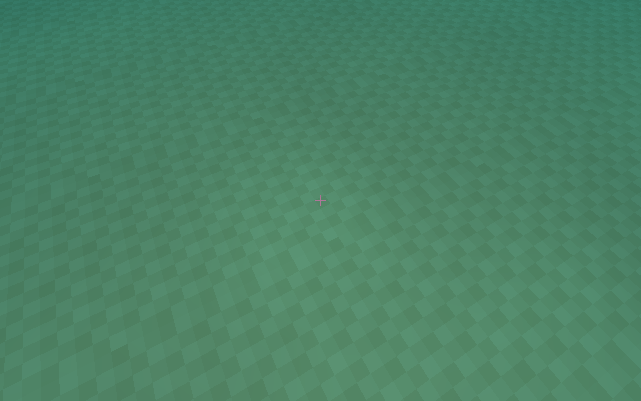
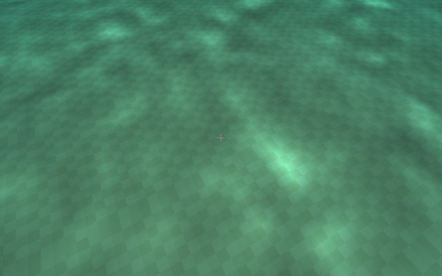

# Underwater direct-light caustics

Enabled by default alongside **Water optical rays (SSR)** and waves. F11 exposes
**Underwater caustics (optical rays)**, strength (default 1), fade distance
(default 64 m), and GPU map-generation time. `--no-caustics` is an A/B control;
`--no-ssr`, disabled transparent water, disabled waves, or zero wave/caustic
strength bypass generation and shading. Direct light must be above the horizon.
The same path supports the active sun or moon direction/intensity.

## Technique

A bounded compute photon-density map avoids an extra caustic ray per shaded
pixel. Its surface-to-light transport follows the photon-tracing/splatting family
used by real-time water-caustic implementations; see [NVIDIA's water caustics
article](https://developer.nvidia.com/blog/generating-ray-traced-caustic-effects-in-unreal-engine-4-part-2/).
This implementation uses virtual depth planes rather than intersections against
the scene or NVIDIA's full photon differential scattering implementation.

`wave_field.wgsl` is shared by surface optics and caustic generation. The baked
64×64 slope texture, six frequency bands, scrolling phases, stochastic rotations,
domain warp, strength and distance filtering are identical. Caustic generation
uses an explicit source-texel footprint instead of the view-pixel footprint, so
sub-texel waves are filtered. No unrelated animated caustic texture is introduced.

Every frame, eligible surface texels refract incoming light through the live
wave normal using the water IOR. Two maps share one **2.75 MiB** device-local
allocation (11 planes of 256² unsigned integers):

| Map | Coverage / spacing | Depth slices | Origin snap |
|---|---|---|---|
| Coarse | 96 m / 0.375 m | 1, 3, 7, 15 m | 6 m |
| Near | 32 m / 0.125 m | 0.25, 0.5, 1, 2, 4 m | 2 m |

Each map includes a source-height plane. Source columns scan near-world
occupancy, skipping empty sections/bricks. The top nonempty voxel must be water,
so roofs and trees suppress covered source columns. Snapping moves origins by
an integer number of texels, preserving the world sampling lattice.

Coarse photons retain four bilinear fixed-point integer-atomic deposits per
plane. Near photons use an **elliptical footprint from refracted ray
differentials**: an 8×8 workgroup shares a 9×9 tile of source rays and its halo.
Neighbor differences estimate the source-to-receiver Jacobian at each depth.
Its covariance spreads diverging photons and narrows converging photons along
the appropriate axes. A 0.3-texel reconstruction floor prevents singular folds;
footprints are bounded to a maximum 9×9 stencil for predictable cost. A smooth
compact Gaussian support avoids abrupt tap-entry popping during animation.
Each footprint is normalized before depositing, including out-of-map taps so
edge clipping cannot concentrate energy. This is a first-order footprint
approximation, not an exact warped-cell overlap calculation.

Sources carry uniform incident flux per horizontal area: geometry is still a
flat water interface with a shading-normal wave field. A normal-cosine flux
weight on that grid would falsely focus light at equal IOR. Fixed-point scale
8192 and bounded source counts fit a 32-bit unsigned accumulator; no float-atomic
extension is required. Quantization introduces small energy/rounding differences.

F11 has independent **Fine near caustic map**, **Adaptive photon footprints**,
and **Shallow caustic depth slices** switches. CLI equivalents are
`--no-caustic-near`, `--no-caustic-adaptive`, `--no-caustic-shallow`.
Disable the near map to compare with the original coarse path. Disable shallow
slices to test the near map at the old 1/3/7/15 m depths. No artistic curvature
boost or temporal caustic history is added in this iteration.

## Receiver lighting

Receivers use their depth below the recorded water surface to interpolate the
photon-density slices. The coarse map keeps its tent filter; the near map uses
bilinear reconstruction without that extra blur because photon footprints
already filter its density. The near map blends to coarse across a 2–4 m edge
guard (considering both receiver and refracted entry), and from 3–4 m depth.
The old-depth comparison mode instead fades from 7–15 m depth.
The adjacent voxel must be water, the water column must connect to the source,
and the mean refracted entry must belong to the same water level. This rejects
dry surfaces, covered pools and disconnected stacked volumes.

Caustics modify the **direct diffuse term**, including secondary water-ray hits
and the soft-shadow denoiser's lighting correction. Shadow visibility still
multiplies this term. Ambient, AO and experimental GI do not receive an additive
caustic contribution. Fresnel transmission, RGB Beer attenuation along the
incident underwater light path, and the refracted Lambert direction are applied.
A horizontal-irradiance normalization avoids gaining energy merely by refracting
the light direction. Strength adjusts focusing around unit density; zero disables
the complete effect.

A smooth distance fade starts at half the selected range and restores ordinary
direct lighting at that range. A second fade guards the map border (10–18 m),
so effective coverage is also limited by the local map. Depth fades in over the
first 0.4 m and fades out from 15 to 24 m. Far terrain and deep oceans therefore
use the ordinary direct-light path rather than requiring larger caustic maps.

## Limits and validation

This is a local, filtered approximation for predominantly horizontal water.
Depth planes interpolate focusing; they do not solve full 3D photon transport.
Existing sun/moon shadows remain responsible for occlusion. The vertical-column
and entry guards cannot reproduce every submerged overhang or blocker on an
oblique refracted path. Neighboring water at different elevations can overlap
in the projected density map. Finite source/map resolution limits sharp folds.
There is no caustic temporal history or volumetric light-shaft simulation.

`--caustics-test --no-audio` exercises the real GPU maps and underwater shading:
energy conservation, distinct depth layers, uniform flux at equal IOR,
deterministic replay, animation,
water/wave/optical-ray/zero-strength gates, ambient isolation, far fade and covered
pool rejection, fine-map energy, incremental near/adaptive/shallow comparisons,
small-time continuity and world-origin snapping. Set `BLOCKWORLD_CAUSTIC_CAPTURE=/tmp/caustics.png` to save shaded
on/off captures, four coarse photon-density slices, and matching legacy/near/
adaptive/shallow images and density maps from a controlled 2 m pool. Readback is headless QA only;
interactive rendering stays on the GPU. Transfer clear and shader writes have
explicit barriers before consumers read the map.

## Controlled comparison

Same camera, 2 m pool depth, replay time 1.25 s, wave strength 0.22. The left
capture uses the legacy coarse map; the right uses the fine map, adaptive photon
footprints and shallow slices. Material, exposure, water and sunlight settings
are identical.

| Legacy | Refined |
|---|---|
|  |  |

See [VALIDATION.md](VALIDATION.md#fine-shallow-water-caustics--2026-10-22) for
incremental image-density contrast and native GPU timings.
