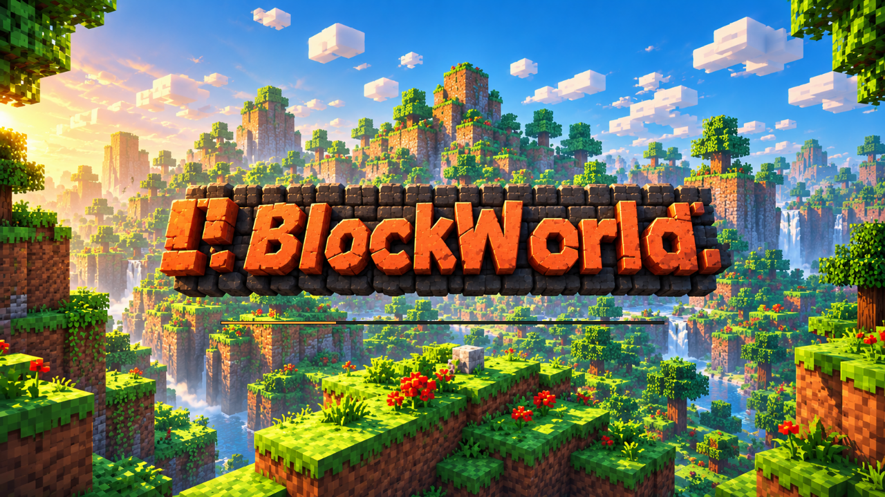

# Loading screen

The supplied 1672×941 artwork is retained in `assets/loading_screen.png`.
`assets/loading_screen.bgra` is its lossless byte-order conversion, embedded in
the executable so startup needs no filesystem lookup or image decoder. To update
it, run `python3 tools/prepare_loading_image.py` with Pillow installed. Pillow is
not a build or runtime dependency.

Startup creates a minimal Vulkan device, swapchain and loading compute pipeline
before world generation or game pipeline compilation. The window becomes visible
once the minimal loading resources are ready. Its first presented frame is the
artwork. The image is fitted without stretching or cropping; other aspect ratios
have dark letterboxing. A thin amber progress bar sits below the logo.

After that first frame, the `world-startup` thread prepares chunks, renderer
resources, initial streamed polygon geometry/acceleration structures and the
first game frame. The main event loop continues displaying the loading image,
handling resize/close and polling completion at approximately 60 Hz. Progress
tracks generated chunk count and completed setup phases, rather than elapsed time.

The loading presenter owns a separate command pool, descriptor set and compute
pipeline. It shares the Vulkan device with the game worker. Queue submissions
use the context's queue lock; GPU uploads and AS preparation retain their usual
completion synchronization. Once ready, the same swapchain transfers to the game
renderer and temporary loading buffers/pipelines are destroyed. ImGui is initialized
on the main thread. Closing or startup failure joins the startup worker and
cleans up partially initialized resources.

The loading compute shader bilinearly samples the artwork and draws the bar
straight into a GPU presentation buffer. There is no rendered-image CPU readback
or software framebuffer in normal operation. The preview above was captured
externally from the native window for visual verification.
