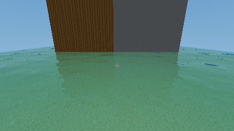
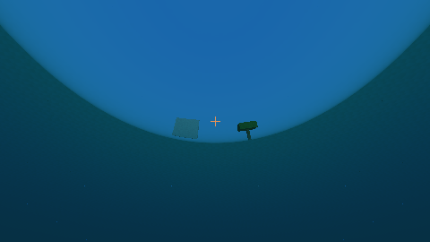
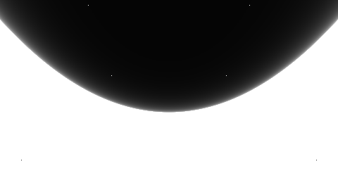

# Water reflections and precomputed bump waves

This fixture is rendered by the Vulkan compute pipeline. The wall is visible
directly and in the pool; the underwater sand remains visible through extinction.

## Try it

- `cargo run --release -- --water-view` starts above a procedural lake.
- `--underwater-view --fly` starts submerged for water/air boundary inspection.
- ImGui toggles **Water optical rays** and **Wave bump** independently; **Wave strength**
  is under Lighting controls. Wave time remains independent of the fish animation toggle.
- `--no-ssr` / `--no-waves` provide repeatable comparisons.
- **Stochastic wave tiling** is enabled by default; toggle it in ImGui or use
  `--no-stochastic-waves` to compare with the original periodic layers.
- F1 (or the View combo) includes **Water reflection coverage**, **Water bump normals**,
  **Water Fresnel / TIR**, **Water path**, and **Reflected voxel material**.
- `--water-test` verifies the controlled pool/wall fixture on Vulkan.
- `BLOCKWORLD_WATER_CAPTURE=/tmp/water.ppm ... --water-test` additionally exports
  shaded, SSR-confidence and bump-normal PPM views for inspection. This is a
  headless test facility; window presentation never reads rendered images to CPU.

## Baked waves and filtering

`waves.rs` evaluates 32 deterministic periodic Fourier modes once at startup,
with diminishing high-frequency amplitude. It bakes a **64×64 RGBA8** tile:
R/G contain signed X/Z slopes, B contains normalized height, and A is opaque.
Slopes are precomputed so shading does not differentiate heights or synthesize a
wave spectrum. Seven CPU-generated mip levels total **21,844 bytes** of texel
payload; Vulkan may allocate more for image alignment/storage.

The default wave model has **six bands**, using source-tile frequencies
0.0137, 0.0330706, 0.0798403, 0.192754, 0.465395 and 1.12359 per metre.
Their tile wavelengths range from approximately 73 m to 0.89 m. Ratios are near
`1 + sqrt(2)` rather than powers of two; each band has its own non-orthogonal
orientation, travel direction and speed. These finite floating-point frequencies
are not mathematically aperiodic, but avoid a deliberately short common period
on the voxel grid. Band weights control slope energy, so broad bands correspond
to larger height amplitudes rather than vanishing slopes.

Two independent procedural quintic gradient-noise fields, sampled at roughly
48 m spatial scale, slowly advect to produce a default 1.5 m domain warp. Their
analytic derivatives form a Jacobian: it transforms each texture footprint and
pulls sampled slopes back to world space, keeping anisotropic filtering and
normal directions consistent with the warp. No additional noise texture or
per-frame wave simulation is allocated. This is visual domain warping; the
field is not obstacle-aware shoreline/river flow.

The three finer bands use stochastic triangular tiling. Each UV lattice vertex
selects a stable hashed rotation/translation, with three neighboring samples
blended using smooth normalized barycentric weights. Each band uses a separate
hash. The lattice spacing is 1.37 source UV units and advects with the band,
independently of chunk/camera boundaries. Dividing by the square root of the
sum of squared weights approximately preserves slope variance. This is not
full histogram-preserving synthesis or displacement of a simulated height field.
The three broad bands stay coherent.

By default the detail bands fade smoothly from **32 to 128 m** camera distance.
The macro bands remain, with a modest slope-strength boost through the blend.
A second fade suppresses bands whose transformed pixel footprint is too large
to resolve; this addresses grazing views as well as distance. Mipmaps and explicit
anisotropic gradients still filter every texture lookup. At extreme distances
unresolvable waves disappear rather than aliasing; this does not add a
prefiltered microfacet/normal-variance BRDF.

At close range the default path needs up to twelve wave texture samples (three
coherent plus three stochastic bands of three samples each). Distant or
unresolved detail bands skip their texture reads. Image storage is unchanged.

The F11 controls **Six wave octaves**, **Wave domain warp (m)** and **Detail fade
distance (m)** allow comparisons. `--no-multiscale-waves` restores the previous
three-band model, `--no-wave-warp` disables only the domain warp, and
`--no-stochastic-waves` disables stochastic sampling. The previous model uses
seven reads with stochastic sampling, or three without it.

The image uses repeat addressing, linear magnification/minification and trilinear
mip selection. `samplerAnisotropy` is enabled when supported and capped at **8×**
(or the device maximum, if lower). Compute shaders use `textureSampleGrad` with
explicit screen-pixel footprints obtained from neighboring rays intersecting the
same water plane. This provides real Vulkan anisotropic filtering at grazing
angles; a fixed LOD or gradients of wrapped UVs would not do that correctly.
Unsupported anisotropy uses the same mipmapped linear sampler without anisotropy.

The combined slope bands perturb horizontal water-interface normals for reflection
and the sun highlight. Underwater entry placeholders and vertical voxel water
faces are not treated as horizontal wave surfaces. Shadow bias uses the original
flat normal, avoiding wave-induced self-shadow artifacts. Geometry, occupancy,
collision and integrated water path lengths remain unchanged.

This is a low-cost **advected precomputed wave approximation**. It does not evolve
Tessendorf's full time-dependent FFT spectrum, apply deep-water dispersion,
displace geometry, generate whitecaps or simulate shoreline interactions. The
baked height channel is retained for study; current runtime shading samples its
precomputed slope channels.

## Reflection, refraction and medium boundaries

The opaque pass writes HDR scene color. Water reads that completed buffer and
visibility data and writes the final packed output; it never reads its own output.
A compute barrier separates the stages. All image data stays on the GPU during
window presentation. The visibility record carries integrated water length,
water/air interface distance/normal, and whether the camera started underwater.

The previous screen-only reflection marched just 32 m and rejected its first
foreground crossing. That could discard tall or distant surfaces and then show
sky. The new reflection traces loaded voxel occupancy up to the selected view
radius, independent of primary-camera frustum culling. It shades the actual hit
material, normal and UV with Lambert lighting and voxel sunlight shadows. Hills,
wood trunks and leaf blocks therefore reflect at their full height, including
outside the current screen. Sky is used only when the reflected voxel ray misses.

A bounded 32-step/32 m screen-space query with six crossing refinements supplements
nearby **polygon** surfaces, using completed opaque depth/color. It is bounded by
the voxel hit so it cannot see polygons through nearer voxel occluders. Secondary
polygon surfaces that are absent from the screen are still unavailable; this is
not a full hardware ray-query reflection pass. Secondary shading also omits SSAO
and polygon shadow rays. These limits do not restrict voxel trees or terrain.

The interface normal faces the incident medium. Air uses IOR 1.0 and water 1.333
(the water value is adjustable in Lighting controls). The shader computes exact
unpolarized dielectric Fresnel and Snell refraction with `eta = n_incident / n_exit`.
Water-to-air rays beyond the approximately 48.6-degree critical angle use **total
internal reflection** and do not trace a transmitted ray. Looking up underwater
therefore produces a refracted Snell window surrounded by reflections of the
submerged scene. Bump normals affect both sides of horizontal interfaces.

A distinct refracted voxel ray supplies transmitted geometry. Beer-Lambert
attenuation and blue-green in-scattering use the water length of each secondary
ray. For submerged cameras the camera-to-interface water segment is attenuated
as well; reflected underwater paths include their return path through water.
The underwater fog density defaults to 2.4 versus the above-water transmission
control's 0.75, and has its own slider for deliberate stronger submerged haze.
Opaque beds and fish reached before an air exit receive fog **without** being
misclassified as a reflective water surface. With no visible interface, only fog
is applied. Additional water intervals accumulate absorption, but are not each
recursively refracted: this remains a single-interface, single-bounce model.

`--no-ssr` is retained as a profiling switch, now disabling optical secondary rays
(reflection and refraction) while retaining water tint and Fresnel sky fallback.
The normal display mode is independent of that switch. Wave maps remain 64²;
block atlas textures are separate 16² resources.

## Profiler and verification

The overlay reports water-pass milliseconds. The shade total includes opaque
lighting and water composition. Uniform ABI is 464 bytes, including IOR, underwater density and scene bounds. WGSL and ray-query GLSL share the same layout.
Bindings 14/15/16 remain HDR color / sampled wave image / sampler. Binding 17
provides compact pixel flags, so dry pixels skip optical work and large visibility
reads. Screen-space polygon queries are skipped when no primary triangle is visible.

`--water-test` verifies reflected color, sky fallback, snow ridges and tree blocks
more than 32 m away, culling independence, underwater bed reflections, critical
angle TIR, low normal-incidence reflectance, no reflection at equal IOR, stronger
underwater fog, bed/interface distinction, wave replay, unchanged geometric
visibility and resized targets. Headless captures are optional QA readback.

## References

- Jerry Tessendorf, [Simulating Ocean Water](https://jtessen.people.clemson.edu/reports/papers_files/coursenotes2004.pdf), course notes. The current approximation is much simpler than the evolving FFT model.
- Vulkan [samplers and anisotropy](https://docs.vulkan.org/spec/latest/chapters/samplers.html).
- Vulkan [explicit image-sampling gradients](https://github.khronos.org/Vulkan-Site/spec/latest/chapters/textures.html).

## Historical screen-only SSR cost (before optical voxel rays)

RTX 2060 SUPER, native 1280×720, stationary `--water-view`, 1000 frames per
release run, validation disabled, no concurrent benchmarks. Stage means exclude
60 warmup frames. All other effects, fish and foliage remain enabled.

| Water mode | Average FPS | Mean water composition | Frame p99 after warmup |
|---|---:|---:|---:|
| Flat, SSR off (`--no-ssr --no-waves`) | 172.7 | 0.378 ms | 6.957 ms |
| Wave bump, SSR off (`--no-ssr`) | 171.3 | 0.377 ms | 8.474 ms |
| Wave bump + SSR (default) | 125.0 | 2.513 ms | 9.564 ms |

The tiny flat-versus-wave difference is within run-to-run noise. Water composition
includes transmission, reflection/sky, highlights, final debug/crosshair and packing;
its SSR increase is about 2.1 ms in this water-heavy view. FPS is an end-to-end
window measurement, not simply inverse GPU time. Other cameras, resolutions and
reflection coverage will have different costs.

## Optical-ray measurement

With the current voxel reflection/refraction model, a native RTX 2060 SUPER
1280×720 run (`--underwater-view --fly --frames 1000`, all default effects and
BGM enabled) averaged **122.5 FPS**, mean water pass **3.912 ms**, and post-warmup
frame p99 **11.208 ms**. This is a different camera/terrain from the historical
screen-only table above and is not a direct before/after comparison.

## Optical material defaults

Water density defaults to 1.0, underwater fog to 0.35, and tone-mapper saturation
to 1.15. Optical water does not sample water-block albedo or resource-pack water
tints/overlays. Absorption/scattering, Fresnel reflection/refraction and the wave
slope maps determine its appearance; solid terrain retains its normal textures.

## Underwater caustics

Wave-correlated direct-light caustics now share the wave field used by surface
optics. Coarse and fine near-field GPU maps with depth slices focus refracted light on underwater
receivers, with local coverage and a smooth return to ordinary lighting at far
distances. They require **Water optical rays (SSR)**. F11 contains caustic
strength/range controls, independent fine-map/adaptive-footprint/shallow-slice
switches and GPU timing; `--no-caustics` disables the effect.
See [CAUSTICS.md](CAUSTICS.md) for transport, storage, filtering and limitations.
